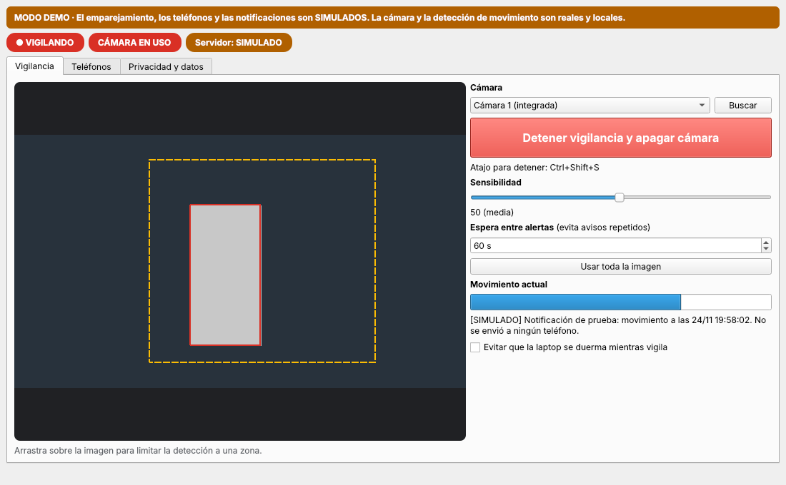

# App de la laptop

App de escritorio en Python (PySide6) para Windows, macOS y Linux.



## Qué hace

- **Iniciar y detener** la vigilancia con un botón grande, desde el icono de la bandeja o con **Ctrl+Shift+S**. Al detener (o cerrar la ventana) la cámara se libera al instante.
- **Elegir cámara** entre las que encuentra el sistema.
- **Indicadores siempre visibles:** «VIGILANDO», «CÁMARA EN USO», estado del servidor y «VISTA EN VIVO ABIERTA» cuando alguien mira desde el teléfono.
- **Detección local** con sensibilidad ajustable, espera entre alertas, confirmación de varios fotogramas (ignora parpadeos de luz) y **zona de detección** que dibujas arrastrando sobre la imagen.
- **Emparejar el teléfono** con un código o QR que caduca y solo sirve una vez.
- **Ver y revocar** los dispositivos con acceso.
- **Vista en vivo** por WebRTC solo mientras vigila; si detienes la vigilancia, se corta.
- **Fotos instantáneas opcionales** (apagadas por defecto), cifradas y guardadas solo en la laptop, con borrado individual, total y automático.
- **Eliminar la cuenta** y revocar todos los dispositivos.
- **Modo demo:** usa la cámara real pero simula el teléfono y las notificaciones, con avisos «SIMULADO» bien visibles.

## Instalación en Windows (tu HP)

1. Instala Python 3.11 o superior desde <https://www.python.org/downloads/>. En el instalador marca **«Add python.exe to PATH»**.
2. Descarga el proyecto: en GitHub pulsa **Code > Download ZIP** y descomprímelo, o usa `git clone`.
3. Abre **PowerShell** en la carpeta `laptop` del proyecto y ejecuta:

   ```powershell
   python -m venv .venv
   .venv\Scripts\activate
   pip install -r requirements.txt
   python -m roomcam_laptop --demo
   ```

4. La primera vez que pulses «Iniciar vigilancia», Windows puede pedir permiso para la cámara. Si la cámara no abre, ve a **Configuración > Privacidad y seguridad > Cámara** y activa **«Permitir que las aplicaciones de escritorio accedan a la cámara»**.

Para usar tu servidor real en vez del modo demo, ejecuta `python -m roomcam_laptop` (sin `--demo`) y elige «Conectar a tu servidor».

## macOS y Linux

Los mismos pasos, cambiando la activación por `source .venv/bin/activate`.

- **macOS:** la primera vez, el sistema pide permiso de cámara para Terminal (o la app desde la que lo abras). Si lo denegaste: Ajustes del Sistema > Privacidad y seguridad > Cámara.
- **Linux:** tu usuario debe estar en el grupo `video` (`sudo usermod -aG video $USER` y vuelve a iniciar sesión). Para guardar el token de forma segura hace falta un llavero (GNOME Keyring o KWallet).

## Dónde se guardan los datos locales

| Dato | Dónde |
|---|---|
| Token de sesión y clave de las fotos | Llavero del sistema (Administrador de credenciales en Windows) |
| Preferencias | `%LOCALAPPDATA%\RoomCam\settings.json` en Windows |
| Fotos instantáneas (si las activas) | `%LOCALAPPDATA%\RoomCam\snapshots\`, cifradas |

## Limitaciones

- La vigilancia funciona mientras la app está abierta (puede estar minimizada). Si la laptop se suspende o se apaga, deja de vigilar y el teléfono la verá como «desconectada». Activa «Evitar que la laptop se duerma» y deja el cargador conectado.
- Cerrar la tapa suele suspender la laptop aunque esa opción esté activa. En Windows puedes cambiarlo en Panel de control > Opciones de energía > «Elegir el comportamiento del cierre de la tapa».

## Pruebas

```bash
pip install -r requirements-dev.txt
python -m pytest
```

Incluye una prueba de extremo a extremo que levanta el servidor real, empareja un teléfono simulado y recibe vídeo por WebRTC.
