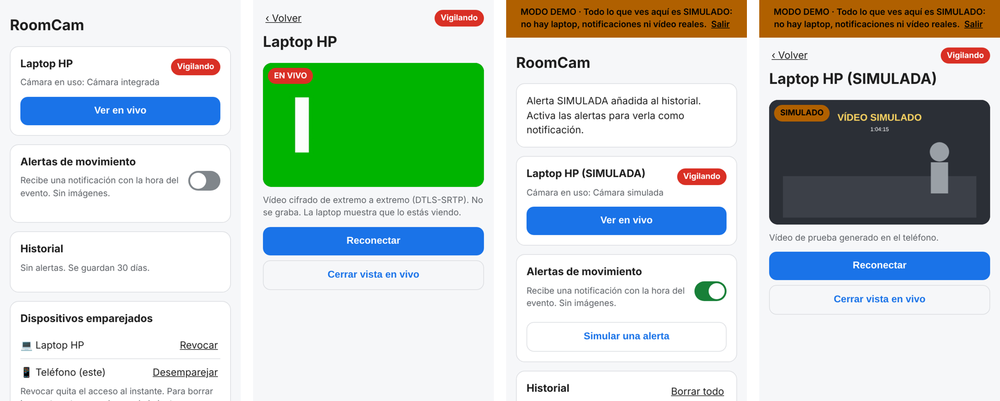

# App del teléfono (PWA)

App web instalable para iPhone y Android. La sirve el propio servidor en `/app/`, así que no hay que publicar nada en App Store ni Google Play.

## Qué hace

- **Emparejar** con el código de 8 caracteres (o el QR) que genera la laptop.
- **Estado de la laptop:** vigilando, vigilancia detenida, dormida o desconectada, actualizado en tiempo real.
- **Activar o desactivar alertas.** La notificación trae solo la hora, el nombre de la laptop y un enlace que abre la vista en vivo.
- **Vista en vivo** por WebRTC (cifrada con DTLS-SRTP), disponible solo mientras la laptop vigila. Mensajes claros si la laptop está apagada, la vigilancia se detiene o el vídeo no conecta.
- **Historial de alertas** con «Borrar todo».
- **Dispositivos emparejados** con «Revocar» y «Desemparejar».
- **Modo demo** con laptop, alertas y vídeo simulados, marcados como SIMULADO.

## Limitaciones en iPhone

- Las notificaciones necesitan **iOS 16.4 o superior** y que la app esté **añadida a la pantalla de inicio**.
- iOS no muestra botones de acción en notificaciones web; al tocar la notificación se abre la vista en vivo.
- El vídeo solo se ve con la app abierta (iOS no permite vídeo en segundo plano en apps web).

## Archivos

| Archivo | Para qué |
|---|---|
| `index.html`, `styles.css`, `app.js` | La app |
| `sw.js` | Recibe las notificaciones push |
| `manifest.webmanifest`, `icons/` | Instalación en la pantalla de inicio |

La prueba `laptop/tests/browser_e2e.py` abre esta app en Chromium, la empareja con una laptop simulada y comprueba que llega vídeo.
